<div align="center">

# SPSDK Security Regression Lab

**Hardware-independent Python regression testing for the cryptographic workflows of NXP Secure Provisioning SDK.**

[](https://github.com/Joun-Mikhail/spsdk-security-regression-lab/actions/workflows/ci.yml)


[](LICENSE)

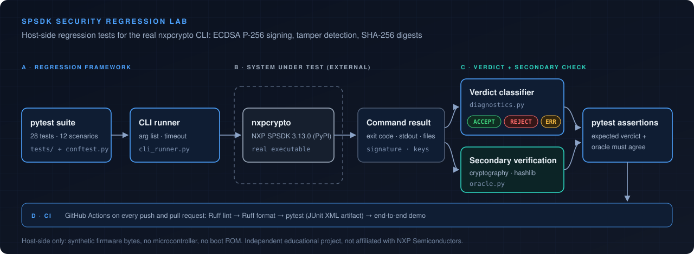

</div>

## In 30 seconds

**The problem.** Before a car's control unit, a medical device or a smart meter runs new
software, its chip checks a **digital signature**: a tamper-evident seal that proves the
software is genuine and has not been changed. NXP's open-source toolkit, SPSDK, is used by
engineers to create and check those seals.

**What I built.** An automated test lab that drives SPSDK's real crypto tool and confirms two
things every time the code changes:

- ✅ **Genuine firmware is accepted.**
- ❌ **Anything altered is rejected:** a single changed byte, the wrong key, a damaged or
  shortened signature, a corrupted key file, or a wrong checksum.

**Why it is interesting.** While building it I found that SPSDK 3.13.0 reports *"success"* (exit
code 0) even when it rejects a fake signature, so a naive automated test could be fooled. The lab
reads the tool's actual verdict instead, and a deliberately planted bug showed that it catches
real mistakes (see [Results](#results-at-a-glance)).

> Independent educational portfolio project. It is not an official NXP project and is not
> affiliated with or endorsed by NXP Semiconductors.

## Results at a glance

| | Result |
|---|---|
| 🧪 Automated tests | **28 of 28 pass**, including **15 negative security tests** |
| 🐧 Linux and GitHub Actions | Pass on every change, checked automatically |
| 🪟 Windows | **28 of 28 pass** and the demo passes (Python 3.12.10, run by hand) |
| 🎯 Does it catch bugs? | Yes. A deliberately planted bug made **7 tests fail** straight away |
| 🔍 Second opinion | Every signature is re-checked with a separate Python library |
| 🔧 Hardware needed | None. Everything runs on an ordinary laptop or CI server |

## See it in action

Every screenshot below is real output from commands that were actually run. The raw text is
linked under each image.

### 1. The full story in one command

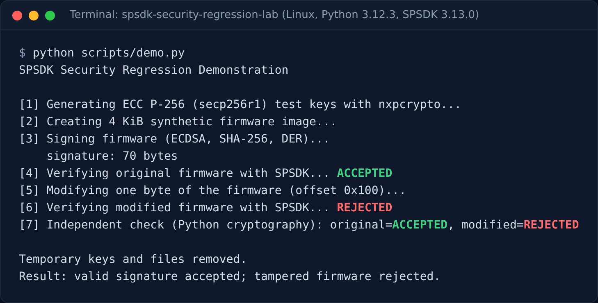

<sub>Create keys, sign a firmware file, check it (accepted), change one byte, check again
(rejected). <code>python scripts/demo.py</code> on Linux, Python 3.12.3, SPSDK 3.13.0
(<a href="assets/screenshots/firmware-demo.txt">raw text</a>).</sub>

### 2. One changed byte is enough to be caught

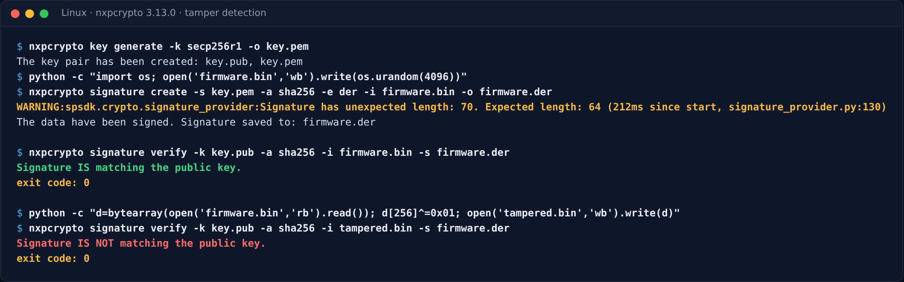

<sub>The same tool, called directly. Green means accepted, red means rejected. Note that
<b>both</b> checks end with <code>exit code: 0</code>: this is the finding explained
<a href="#the-key-finding">below</a>. The yellow WARNING line is SPSDK's own log message and
does not affect the result (<a href="assets/screenshots/tamper-detection.txt">raw text</a>).</sub>

### 3. The wrong key is refused

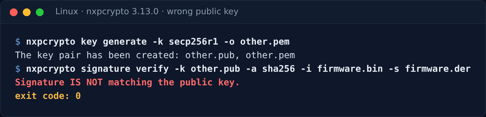

<sub>A genuine signature checked against someone else's key is rejected, just as a seal from the
wrong manufacturer would be (<a href="assets/screenshots/wrong-key.txt">raw text</a>).</sub>

### 4. Checksums catch a single wrong character

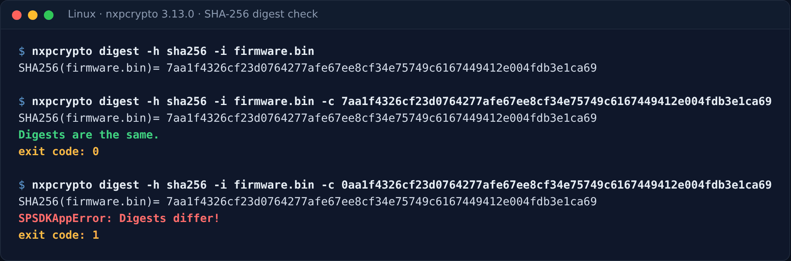

<sub>A SHA-256 checksum is a fingerprint of the file. The correct fingerprint matches, and one
wrong character is reported (<a href="assets/screenshots/digest-check.txt">raw text</a>).</sub>

### 5. All 15 negative security tests pass

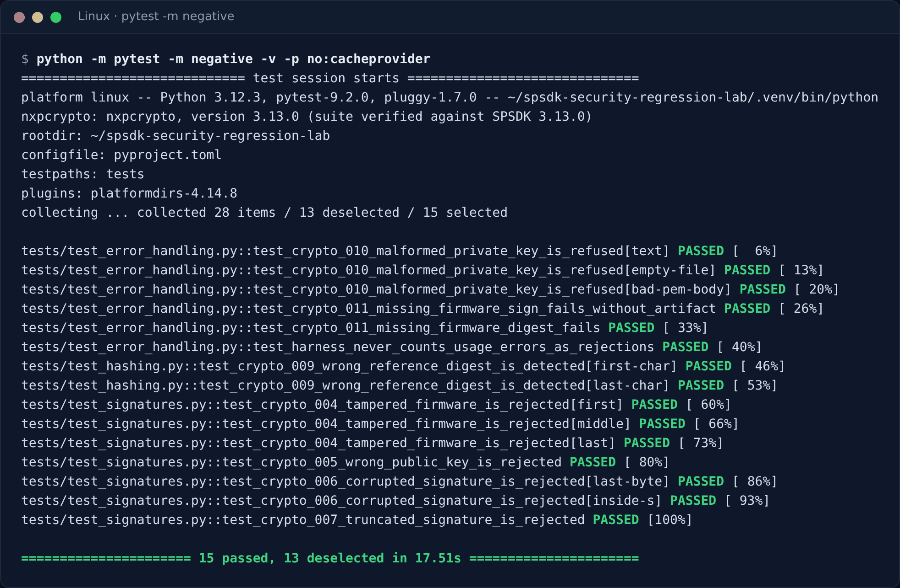

<sub><code>python -m pytest -m negative -v</code> on Linux. Fourteen tests each try one way to
break the security check and pass only if SPSDK rejects it. The fifteenth checks that the test
harness itself never mistakes an error for a rejection
(<a href="assets/screenshots/negative-tests.txt">raw text</a>).</sub>

### 6. It also runs on Windows

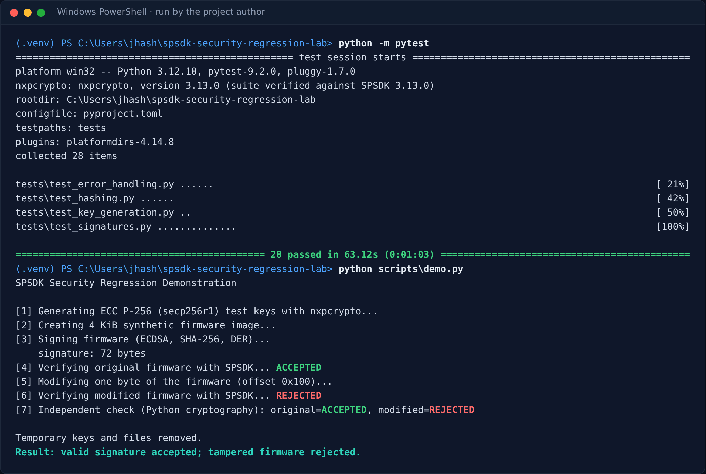

<sub>Output from a manual run on the author's Windows PC, copied from the terminal and rendered
here as an image (<a href="assets/screenshots/windows-run.txt">raw text</a>). Windows is not part
of the automated CI.</sub>

## Skills demonstrated

| Skill | Where it shows |
|---|---|
| Python test automation | A pytest framework with fixtures, parametrised tests and markers |
| Security and negative testing | 15 tests that try to break the signature check and must be rejected |
| Test design and reliability | Positive controls and a three-way verdict, so a broken test can never pass by accident |
| Cryptography fundamentals | ECDSA P-256 signatures, SHA-256 digests, public and private keys |
| CI/CD | GitHub Actions runs linting, tests and the demo on every change |
| Debugging vendor tools | Found and documented SPSDK's exit-code behaviour |
| Technical writing | Test plan, traceability matrix, architecture notes and limitations |

## The key finding

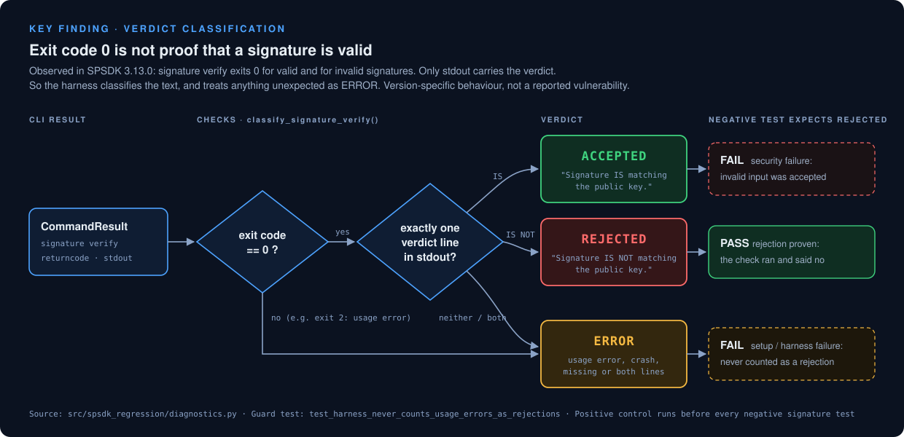

**In plain words:** most automated tools signal "it worked" with exit code 0 and "it failed" with
anything else. In SPSDK 3.13.0, `nxpcrypto signature verify` returns 0 **both** when a signature
is valid and when it is fake (screenshot 2 above). Only the printed sentence tells them apart. A
test that trusted the exit code would wave a forged signature through, and a test that expected
"any failure" would also pass on a simple typo.

**What the lab does about it:** [`diagnostics.py`](src/spsdk_regression/diagnostics.py) reads
the exact verdict sentence and sorts every result into `ACCEPTED`, `REJECTED` or `ERROR`. A
security test passes only on a real `REJECTED`, never on an `ERROR`. The guard test
`test_harness_never_counts_usage_errors_as_rejections` locks this in. This is recorded as
version-specific observed behaviour, not reported as an SPSDK vulnerability.

---

# Technical details

The rest of this page is for engineers who want to see how it works.

## What it tests

| | |
|---|---|
| **System under test** | [NXP SPSDK](https://github.com/nxp-mcuxpresso/spsdk) 3.13.0 `nxpcrypto`, installed from PyPI and never mocked |
| **Operations** | ECC P-256 key generation, ECDSA/SHA-256 signing, signature verification, SHA-256 digests |
| **Security behaviour validated** | Valid signatures are accepted. Tampered firmware, a wrong public key, corrupted or truncated signatures, malformed keys and wrong digests are rejected |
| **Evidence** | 28 of 28 tests pass in CI on every push; a deliberate harness defect made 7 tests fail |

## Key engineering capabilities

- **Real system under test.** Every test executes the installed `nxpcrypto` binary through
  `subprocess`. Nothing is mocked.
- **Negative security tests with proof.** Each negative signature test first runs a positive
  control. It then changes one input and requires SPSDK's explicit rejection.
- **Three-way verdicts.** `ACCEPTED`, `REJECTED` and `ERROR` are kept apart, so a broken setup
  can never pass as a successful rejection.
- **Secondary verification.** SPSDK signatures are re-verified with Python `cryptography`, and
  digests are compared with `hashlib`.
- **Safe CLI runner.** It uses argument lists (no shell), timeouts and full output capture, and
  never logs key material.
- **CI on every change.** Ruff lint and format, pytest with a JUnit artifact, and the end-to-end
  demo.

## Architecture

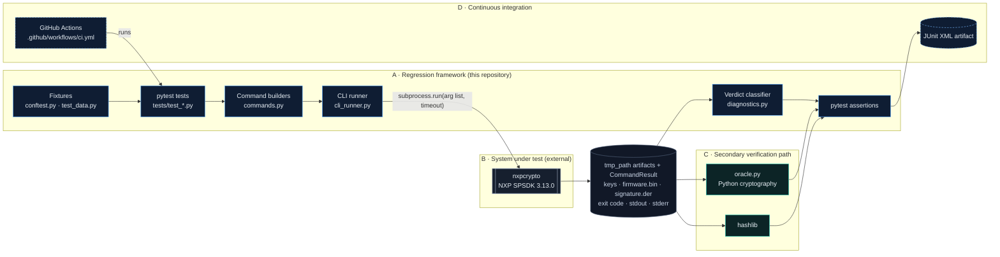

The framework never touches hardware. SPSDK runs as an ordinary host program, and the "firmware"
is synthetic bytes in a temporary directory. Component details:
[docs/architecture.md](docs/architecture.md).

## Cryptographic verification flow

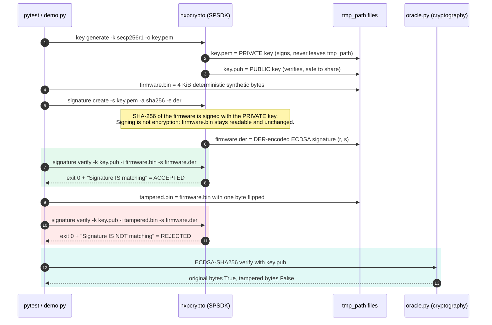

The secondary check uses a separate code path, the Python `cryptography` package. Note that
it is not a fully independent implementation: SPSDK also builds on `cryptography` and OpenSSL.

## Test coverage

12 scenarios plus 3 edge-case and harness checks give **28 test cases** (15 of them are
security-negative).

| ID | Scenario | Expected |
|---|---|---|
| CRYPTO-001 | P-256 key generation | keys load, curve secp256r1, pair matches |
| CRYPTO-002 | Sign 1 B / 256 B / 4 KiB | valid DER, verified by oracle |
| CRYPTO-003 | Verify valid signature | ACCEPTED |
| CRYPTO-004 | Flip one firmware byte (×3) | REJECTED |
| CRYPTO-005 | Unrelated public key | REJECTED |
| CRYPTO-006 | Corrupt one signature byte (×2) | REJECTED |
| CRYPTO-007 | Truncated signature | REJECTED |
| CRYPTO-008 | SHA-256 of 0 B to 4 KiB (×4) | equals `hashlib` |
| CRYPTO-009 | Wrong reference digest (×2) | `Digests differ!` |
| CRYPTO-010 | Malformed private key (×3) | `SPSDKError`, no signature file |
| CRYPTO-011 | Missing input file (×2) | error, no false success |
| CRYPTO-012 | Secondary verification | original ✓, modified ✗ |

The full plan with setup, actions and executed results is in
[docs/test_plan.md](docs/test_plan.md).

## Test evidence

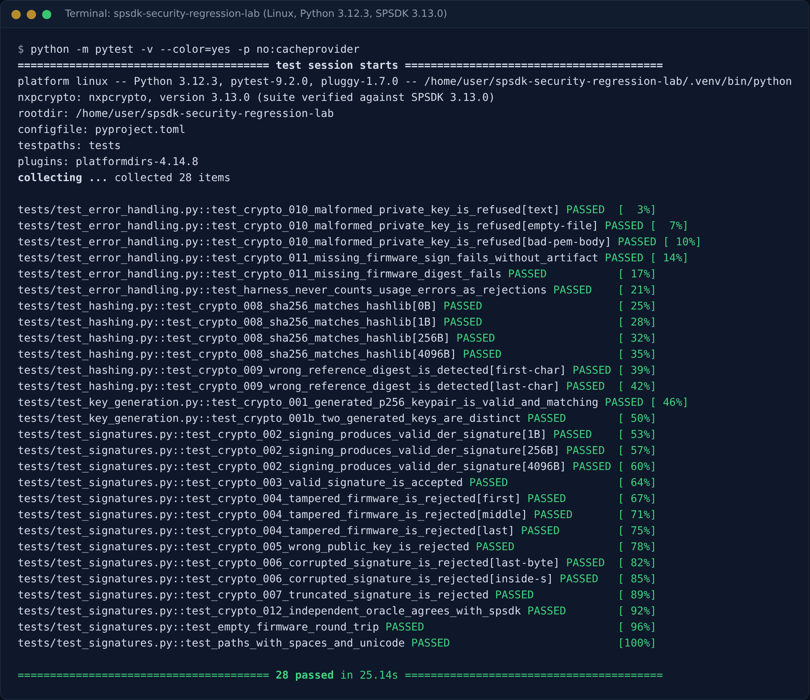

<sub>Real local run on Linux, 2026-11-23 (<a href="assets/screenshots/pytest-results.txt">raw
text</a>): 28 collected, 28 passed, 0 failed, 0 skipped.</sub>

**Regression detection.** When the classifier was deliberately made to accept every verdict,
7 negative tests failed (CRYPTO-004 to 007). When it was made to count errors as rejections, the
guard test failed. Both changes were reverted and never committed. Details are in
[docs/test_plan.md](docs/test_plan.md#regression-detection-mutation-evidence).

## CI/CD pipeline

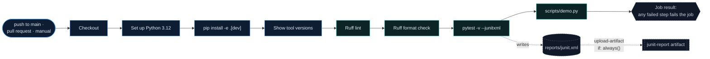

The diagram follows [`.github/workflows/ci.yml`](.github/workflows/ci.yml) step for step. The
report upload runs even when tests fail, so evidence is kept without hiding the failure. See the
[Actions history](https://github.com/Joun-Mikhail/spsdk-security-regression-lab/actions/workflows/ci.yml)
for every run, its step results and the downloadable `junit-report`.

## Quick start

Requires Python 3.12. No hardware, accounts or secrets are needed.

**Linux** (verified; macOS should work the same way but is untested)

```bash
git clone https://github.com/Joun-Mikhail/spsdk-security-regression-lab.git
cd spsdk-security-regression-lab
python3.12 -m venv .venv && source .venv/bin/activate
python -m pip install --upgrade pip
python -m pip install -e ".[dev]"
```

**Windows PowerShell** (verified by hand: 28 passed, demo passed)

```powershell
git clone https://github.com/Joun-Mikhail/spsdk-security-regression-lab.git
cd spsdk-security-regression-lab
py -3.12 -m venv .venv; .\.venv\Scripts\Activate.ps1
python -m pip install --upgrade pip
python -m pip install -e ".[dev]"
```

If PowerShell refuses to run `Activate.ps1`, allow it for this session only with
`Set-ExecutionPolicy -Scope Process -ExecutionPolicy RemoteSigned`.

## Running the tests

```bash
python -m pytest -v                                # full suite
python -m pytest -m negative -v                    # security-negative tests only
python -m pytest -v --junitxml=reports/junit.xml   # with a JUnit report, as CI does
python -m ruff check . && python -m ruff format --check .
python scripts/demo.py                             # end-to-end demonstration
```

## Limitations

- **Host-side only.** There is no microcontroller, boot ROM, fuses, secure enclave or
  provisioning, and the synthetic firmware is never executed.
- **Narrow scope.** Only P-256, SHA-256 and DER encoding are covered. Real SPSDK image formats
  (MBI, AHAB, HAB) are not.
- **Verified environments.** Linux locally and in GitHub Actions (automated), and Windows with
  PowerShell 5.1 and Python 3.12.10 (run by hand, not part of CI). macOS is untested.
- **Not an audit.** This is not a security assessment or certification of SPSDK.

The full list is in [docs/limitations.md](docs/limitations.md).

## Documentation

| Document | Contents |
|---|---|
| [Architecture](docs/architecture.md) | components, failure classes, observed CLI semantics, diagram notes |
| [Test plan](docs/test_plan.md) | test IDs, setup, expected outcomes, executed results, mutation evidence |
| [Requirements traceability](docs/requirements_traceability.md) | skills mapped to implementation and evidence |
| [Limitations](docs/limitations.md) | what is and is not validated |
| [Learning guide](docs/interview_guide.md) | plain-language explanations of the concepts |
| [Application materials](docs/application_materials.md) | project summary texts |

## References and license

- SPSDK repository: <https://github.com/nxp-mcuxpresso/spsdk> (BSD-3-Clause, used as an installed dependency)
- SPSDK 3.13.0 documentation: <https://spsdk.readthedocs.io/en/v3.13.0/>
- `nxpcrypto` CLI reference: <https://spsdk.readthedocs.io/en/v3.13.0/apps/nxpcrypto.html>

This project is released under the [MIT License](LICENSE). NXP and SPSDK are named only to identify
the open-source software under test. All keys are disposable and generated at test time.
