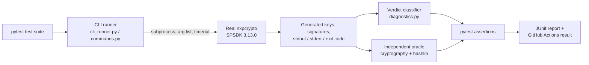

# NXP SPSDK Security Regression Lab

[](https://github.com/Joun-Mikhail/spsdk-security-regression-lab/actions/workflows/ci.yml)

A hardware-free pytest regression suite for the cryptographic commands of NXP's open-source
[Secure Provisioning SDK (SPSDK)](https://github.com/nxp-mcuxpresso/spsdk). It runs the real
`nxpcrypto` command-line tool from SPSDK 3.13.0 to generate ECC keys, sign a synthetic firmware
image, verify signatures and compute SHA-256 digests. It then checks every result against an
independent oracle (Python `cryptography` / `hashlib`) and feeds the tool deliberately invalid
inputs to confirm they are rejected.

> This is an independent educational portfolio project. It is not an official NXP project and
> is not affiliated with or endorsed by NXP Semiconductors.

## Why this kind of testing matters

Secure boot depends on firmware signing tools doing exactly two things right: valid signatures
must verify, and anything tampered with (firmware, signature or key) must **not** verify. A
regression in either direction is a security bug. This suite pins both directions down and
re-checks them automatically on every change.

## Key features

- **Real system under test.** Every test runs the installed `nxpcrypto` executable through
  `subprocess`. SPSDK is never mocked.
- **Positive and negative tests.** Valid signing and verification, plus tampered firmware, a wrong
  public key, corrupted and truncated signatures, malformed keys, missing files and a wrong
  reference digest.
- **Independent oracle.** Signatures produced by SPSDK are verified again with the Python
  `cryptography` package, and digests are compared with `hashlib`.
- **False-positive protection.** Each negative test first runs a positive control with the same
  command. A rejection only counts when SPSDK explicitly prints its "not matching" verdict.
  Usage errors and crashes are classified as `ERROR` and fail the test.
- **Safe CLI runner.** It uses argument lists (never `shell=True`), applies timeouts, captures
  stdout, stderr and the exit code, and prints readable diagnostics. No key material is ever
  logged.
- **Demo script** showing tamper detection in about 10 seconds.
- **GitHub Actions CI** running Ruff and pytest, with a JUnit report uploaded as an artifact.

### A finding worth knowing about

In SPSDK 3.13.0, `nxpcrypto signature verify` exits with code **0 even when the signature is
invalid**. The verdict appears only in stdout (`Signature IS matching ...` versus
`Signature IS NOT matching ...`). A test that only checked the exit code would therefore treat a
forged signature as valid. The harness in
[`diagnostics.py`](src/spsdk_regression/diagnostics.py) classifies the output explicitly for this
reason. This is documented as observed behaviour, not reported as an SPSDK bug.

## Architecture



More detail is in [docs/architecture.md](docs/architecture.md).

## Test coverage

| ID | Scenario | Expected result | Test |
|---|---|---|---|
| CRYPTO-001 | Generate a P-256 key pair | Keys load, curve is secp256r1, public matches private; two keys differ | `test_key_generation.py` |
| CRYPTO-002 | Sign 1 B / 256 B / 4 KiB firmware | Non-empty, well-formed DER ECDSA signature that the oracle verifies | `test_signatures.py` |
| CRYPTO-003 | Verify a valid signature | SPSDK reports `IS matching` | `test_signatures.py` |
| CRYPTO-004 | Flip one firmware byte (first, middle, last) | SPSDK reports `IS NOT matching` | `test_signatures.py` |
| CRYPTO-005 | Verify with an unrelated valid key | Rejected | `test_signatures.py` |
| CRYPTO-006 | Corrupt one signature byte | Rejected | `test_signatures.py` |
| CRYPTO-007 | Truncate the signature | Rejected, never reported as valid | `test_signatures.py` |
| CRYPTO-008 | SHA-256 of 0 B / 1 B / 256 B / 4 KiB | `nxpcrypto digest` equals `hashlib.sha256` | `test_hashing.py` |
| CRYPTO-009 | Reference digest with one wrong hex character | `Digests differ!`, exit code 1 | `test_hashing.py` |
| CRYPTO-010 | Sign with a malformed key (text, empty, bad PEM) | `SPSDKError`, no traceback, no signature file | `test_error_handling.py` |
| CRYPTO-011 | Sign or hash a missing file | Non-zero exit, no false success, no output file | `test_error_handling.py` |
| CRYPTO-012 | Independent verification of an SPSDK signature | Original verifies, modified data does not | `test_signatures.py` |
| Extra | Empty firmware, paths with spaces and Unicode, harness self-check | See [docs/test_plan.md](docs/test_plan.md) | |

These 12 scenarios expand into 28 pytest test cases through a small amount of parametrization.

## Quick start

Requires Python 3.12. No hardware, accounts or secrets are needed.

**Linux / macOS**

```bash
git clone https://github.com/Joun-Mikhail/spsdk-security-regression-lab.git
cd spsdk-security-regression-lab
python3.12 -m venv .venv
source .venv/bin/activate
python -m pip install --upgrade pip
python -m pip install -e ".[dev]"
```

**Windows PowerShell**

```powershell
git clone https://github.com/Joun-Mikhail/spsdk-security-regression-lab.git
cd spsdk-security-regression-lab
py -3.12 -m venv .venv
.\.venv\Scripts\Activate.ps1
python -m pip install --upgrade pip
python -m pip install -e ".[dev]"
```

## Running the tests

```bash
python -m pytest -v                                   # full suite
python -m pytest -v --junitxml=reports/junit.xml      # with a JUnit report, as CI does
python -m pytest -m negative -v                       # only the security-negative tests
python -m ruff check .                                # lint
python -m ruff format --check .                       # formatting
python scripts/demo.py                                # demonstration
```

## Example output

Output from a real local run on Linux with Python 3.12.3 and SPSDK 3.13.0:

```text
$ python scripts/demo.py
SPSDK Security Regression Demonstration

[1] Generating ECC P-256 (secp256r1) test keys with nxpcrypto...
[2] Creating 4 KiB synthetic firmware image...
[3] Signing firmware (ECDSA, SHA-256, DER)...
    signature: 72 bytes
[4] Verifying original firmware with SPSDK... ACCEPTED
[5] Modifying one byte of the firmware (offset 0x100)...
[6] Verifying modified firmware with SPSDK... REJECTED
[7] Independent check (Python cryptography): original=ACCEPTED, modified=REJECTED

Temporary keys and files removed.
Result: valid signature accepted; tampered firmware rejected.
```

```text
$ python -m pytest
nxpcrypto: nxpcrypto, version 3.13.0 (suite verified against SPSDK 3.13.0)
collected 28 items
...
============================= 28 passed in 23.29s ==============================
```

The DER signature length varies between 70 and 72 bytes because ECDSA signatures are randomized.
SPSDK also logs a harmless `Signature has unexpected length` warning when DER encoding is chosen.

### Regression-detection check

To show that the suite catches harness mistakes, two deliberate defects were introduced locally,
run, and then reverted (they were never committed):

1. The signature classifier was changed to report every verdict as "accepted". **7 tests failed**
   (all of CRYPTO-004 to CRYPTO-007) with `SECURITY FAILURE: invalid input was unexpectedly
   ACCEPTED`, pytest exited with code 1, and the demo exited with code 1.
2. The classifier was changed to count any CLI error as a security rejection. The
   `test_harness_never_counts_usage_errors_as_rejections` guard test **failed**.

After both changes were reverted, all 28 tests passed again. This shows the tests detect a
broken harness. It is not a bug found in SPSDK.

## Continuous integration

[`.github/workflows/ci.yml`](.github/workflows/ci.yml) runs on pushes to `main`, on pull requests
and on manual dispatch. It uses Ubuntu with Python 3.12: it installs the pinned dependencies,
prints tool versions, runs Ruff (lint and format), runs pytest with JUnit XML, runs the demo, and
uploads `reports/junit.xml` as an artifact even when tests fail. Any failing step fails the job.

## Limitations

The suite tests a host-side CLI tool against synthetic data. It does **not** test MCU boot ROM
behaviour, secure boot on real hardware, provisioning or secure enclaves, and it is not a security
audit or certification of SPSDK. Results apply only to SPSDK 3.13.0 on the environments listed
above. See [docs/limitations.md](docs/limitations.md).

## Technologies

Python 3.12, NXP SPSDK 3.13.0 (`nxpcrypto`), pytest, Python `cryptography`, `hashlib`,
`subprocess`, Ruff, Git and GitHub Actions.

## Documentation

- [Architecture](docs/architecture.md)
- [Test plan](docs/test_plan.md)
- [Requirements traceability](docs/requirements_traceability.md)
- [Limitations](docs/limitations.md)
- [Interview / learning guide](docs/interview_guide.md)
- [Application materials](docs/application_materials.md)

## References

- SPSDK repository: <https://github.com/nxp-mcuxpresso/spsdk>
- SPSDK 3.13.0 documentation: <https://spsdk.readthedocs.io/en/v3.13.0/>
- `nxpcrypto` CLI reference: <https://spsdk.readthedocs.io/en/v3.13.0/apps/nxpcrypto.html>

## Disclaimer

This is an independent educational portfolio project. It is not an official NXP project and is not
affiliated with or endorsed by NXP Semiconductors. NXP and SPSDK are referenced only to identify
the open-source software under test, which is distributed under its own BSD-3-Clause license.
All keys used here are disposable and generated at test time. Do not use this project to handle
production keys.

## License

MIT. See [LICENSE](LICENSE).
