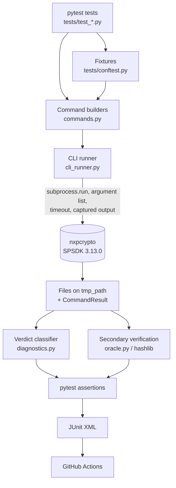

# Architecture

## Overview

## Components

| Component | File | Responsibility |
|---|---|---|
| System under test | installed `spsdk==3.13.0` | Provides the `nxpcrypto` executable. It is used as installed from PyPI and is never copied or mocked. |
| CLI runner | `src/spsdk_regression/cli_runner.py` | Locates `nxpcrypto` (first beside the active interpreter, so it works with a venv on Windows and Linux, then on `PATH`) and runs it with an argument list and a timeout. It returns an immutable `CommandResult` with the command, exit code, stdout, stderr and duration. |
| Command builders | `src/spsdk_regression/commands.py` | One small function per CLI command (`key generate`, `key verify`, `signature create/verify`, `digest`), so each test shows exactly which real command it runs. |
| Verdict classifier | `src/spsdk_regression/diagnostics.py` | Converts raw output into `ACCEPTED`, `REJECTED` or `ERROR`, parses digest lines strictly, and builds failure messages that name the failure class. |
| Test data | `src/spsdk_regression/test_data.py` | Deterministic pseudo-random "firmware" bytes (fixed seed), single-byte flips and single-hex-digit digest corruption. |
| Secondary verification (oracle) | `src/spsdk_regression/oracle.py` | Loads keys and verifies DER ECDSA/SHA-256 signatures with the Python `cryptography` package. It never calls SPSDK, but SPSDK also uses `cryptography` and OpenSSL, so it is a separate code path rather than a fully independent implementation. |
| Fixtures | `tests/conftest.py` | Fresh key pairs, firmware and signed firmware for each test, inside pytest's `tmp_path`. A session fixture fails fast if `nxpcrypto` is missing. |
| CI | `.github/workflows/ci.yml` | Ubuntu with Python 3.12. Runs Ruff, pytest with JUnit XML and the demo, and uploads the report. |

## Failure classification

The brief required that infrastructure problems can never be mistaken for security verdicts.
This is how each case is handled:

| Situation | How it surfaces |
|---|---|
| `nxpcrypto` not installed | `ExecutableNotFoundError` from the session fixture, so every test **errors** |
| Command hangs | `CommandTimeoutError` (default 60 s), so the test **errors** |
| Invalid test setup (wrong path or option) | Exit code 2 with `Error:`, classified as `ERROR`, so the negative test **fails** with "SETUP/HARNESS FAILURE" |
| Expected cryptographic rejection | `Signature IS NOT matching` or `Digests differ!`, classified as `REJECTED`, so the test passes |
| Unexpected rejection of valid input | Classified as `REJECTED` where `ACCEPTED` was expected: "UNEXPECTED REJECTION" |
| Unexpected acceptance of invalid input | Classified as `ACCEPTED` where `REJECTED` was expected: "SECURITY FAILURE" |

Each negative signature test also runs a **positive control** first: the identical command with
unmodified inputs must be `ACCEPTED`. This shows that the paths, options and keys are correct,
so the later rejection can only come from the single input that was changed.

## Observed CLI semantics (SPSDK 3.13.0)

| Command | Valid case | Invalid case |
|---|---|---|
| `signature verify` | exit 0, `Signature IS matching the public key.` | exit **0**, `Signature IS NOT matching the public key.` |
| `digest -c <ref>` | exit 0, `Digests are the same.` | exit 1, `SPSDKAppError: Digests differ!` |
| `key verify` | exit 0, `Keys match.` | exit 1, `Keys are NOT a valid pair!` |
| `signature create` with bad key | n/a | exit 2, `SPSDKError: ... Cannot load ... private key` |
| Any command with a missing input file | n/a | exit 2, a Click usage error or `SPSDKError ... not found` |

`key generate -o name.pem` writes the private key to `name.pem` and the public key to `name.pub`.

## Security practices in the harness

- `subprocess.run` is always called with an argument tuple. `shell=True` is never used.
- Every call has a timeout.
- Keys are generated fresh in temporary directories and deleted by pytest. `*.pem`, `*.pub` and
  `*.der` are in `.gitignore`.
- No passwords or key contents are passed on the command line or printed. Diagnostics show the
  command (file paths only), the exit code and the CLI output.
- No custom cryptography: the oracle uses the `cryptography` package and `hashlib`.

## Diagrams

The README uses five diagrams. Each one is described here: what it shows, which modules it
covers, and the engineering decision it makes visible.

### System overview (`assets/diagrams/system-overview.svg`)

- **What it represents:** the whole lab on one screen. The pytest suite (A) drives the real
  `nxpcrypto` executable (B), the results go to the verdict classifier and to secondary
  verification (C), and GitHub Actions (D) runs everything on each push and pull request.
- **Modules:** `tests/`, `conftest.py`, `cli_runner.py`, `diagnostics.py`, `oracle.py`, `ci.yml`.
- **Key decision:** SPSDK is treated as an external black box. It is installed from PyPI and
  called as a process, never imported, copied or mocked, so the tests exercise the same CLI a
  user runs.

### Architecture (Mermaid, README)

- **What it represents:** the call path from fixtures to assertions, grouped into the four
  boundaries: A regression framework, B system under test, C secondary verification, D CI.
- **Modules:** `conftest.py`, `test_data.py`, `commands.py`, `cli_runner.py`, `diagnostics.py`,
  `oracle.py`, `hashlib`.
- **Key decision:** all process handling lives in one place (`cli_runner.py`, argument list,
  timeout, captured output), so a missing executable or a hang is reported as a harness error
  and never as a security verdict.

### Signature flow (Mermaid sequence diagram, README)

- **What it represents:** one signing and verification round: key generation, signing with the
  private key, verification with the public key, a one-byte tamper and the secondary check.
- **Modules:** `commands.py` (`key_generate`, `signature_create`, `signature_verify`),
  `test_data.py` (`flip_byte`), `oracle.py` (`ecdsa_sha256_verify`).
- **Key decision:** signing is not encryption. The firmware stays readable, so the tests check
  integrity and origin, and never compare signature bytes, because ECDSA signatures are
  randomised.

### Verdict classification (`assets/diagrams/verdict-classification.svg`)

- **What it represents:** how `classify_signature_verify()` turns a `CommandResult` into
  `ACCEPTED`, `REJECTED` or `ERROR`, and what each verdict means for a negative test.
- **Modules:** `diagnostics.py`, and the guard test
  `test_harness_never_counts_usage_errors_as_rejections` in `tests/test_error_handling.py`.
- **Key decision:** in SPSDK 3.13.0 `signature verify` exits 0 for valid and invalid
  signatures, so the exit code alone proves nothing. The harness requires exactly one exact
  verdict line, and anything else is `ERROR`, which can never count as a rejection. This is
  version-specific CLI behaviour, not a reported vulnerability.

### CI pipeline (Mermaid, README)

- **What it represents:** the steps of `.github/workflows/ci.yml` in order: checkout, Python
  3.12, install, tool versions, Ruff lint, Ruff format check, pytest with JUnit XML, the demo,
  and the artifact upload.
- **Modules:** `.github/workflows/ci.yml`, `scripts/demo.py`, `pyproject.toml`.
- **Key decision:** the JUnit report is uploaded with `if: always()`, so the evidence is kept
  even when a test fails.
